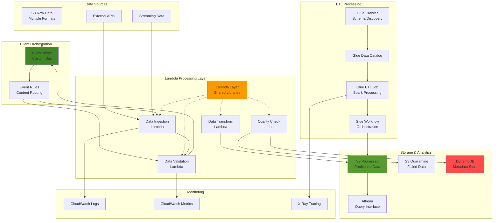

# Serverless Data Lake Architecture

Enterprise-grade serverless data lake on AWS with Lambda layers for shared code, Glue for scalable ETL, and EventBridge for event-driven orchestration — including automated data quality validation and intelligent routing.

## Problem

Enterprise organizations struggle to build scalable data lake architectures that can handle complex data processing workflows while maintaining code reusability and efficient dependency management. Traditional approaches often result in duplicated code across multiple Lambda functions, large deployment packages, and tightly coupled pipelines that are difficult to maintain and scale. Companies need a sophisticated serverless architecture that leverages shared libraries, orchestrates complex ETL workflows, and provides event-driven processing while ensuring cost optimization.

## Solution

An advanced serverless data lake using AWS Lambda layers for shared dependencies, AWS Glue for scalable ETL processing, and Amazon EventBridge for event-driven orchestration. The architecture includes enterprise-grade patterns such as automated data quality validation, cross-service communication through custom events, intelligent data routing based on content and metadata, support for multiple data formats, and comprehensive monitoring and error handling.

## Architecture

## Key Features

- **Lambda layers** — shared `DataProcessor` and `DataValidator` utilities plus dependencies (pandas, numpy, jsonschema) reused across all functions
- **Custom EventBridge bus** — content-based routing rules for ingestion, validation, and quality events with loose coupling between stages
- **Data ingestion** — S3 event-triggered Lambda that parses JSON/CSV, stores lineage metadata, and publishes downstream events
- **Data validation gate** — schema validation, field-level checks (email, phone, date), and quality scoring with automatic quarantine of failing data
- **Glue ETL** — crawler-driven schema discovery into the Glue Data Catalog, scheduled crawls, and Spark-based ETL jobs
- **Quality monitoring** — CloudWatch custom metrics for validation success rate, average quality score, and processed record counts
- **Data lineage** — DynamoDB metadata store tracking every record's processing stage, status, and errors

## AWS Services

| Service | Purpose |
|---|---|
| Lambda | Ingestion, validation, transformation, and quality monitoring functions |
| Lambda Layers | Shared libraries and utilities across all functions |
| EventBridge | Custom event bus and content-based routing rules |
| S3 | Raw, processed, and quarantine data lake buckets |
| Glue | Crawlers, Data Catalog, and Spark ETL jobs |
| DynamoDB | Processing metadata and lineage store |
| Athena | Serverless SQL query interface over processed data |
| CloudWatch / X-Ray | Logs, custom metrics, and distributed tracing |
| IAM | Least-privilege Lambda and Glue service roles |

## Prerequisites

1. AWS account with permissions for Lambda, Glue, EventBridge, S3, DynamoDB, IAM, and CloudWatch
2. AWS CLI v2 installed and configured (or AWS CloudShell)
3. Advanced understanding of serverless architectures and data processing patterns
4. Python 3.9+ knowledge for Lambda function development
5. Understanding of ETL concepts and data lake architectures
6. Estimated cost: **$15–25** for 4–6 hours of testing (includes Glue job execution time)

> **Note:** This project creates multiple AWS resources that will incur charges. Follow the cleanup steps to avoid ongoing costs.

## Implementation Overview

1. **IAM roles** — Lambda role with scoped S3, DynamoDB, EventBridge, Glue, X-Ray, and CloudWatch permissions
2. **Lambda layer** — packaged shared utilities (`data_utils.py`) and dependencies published as a layer version
3. **EventBridge bus and rules** — custom bus with ingestion, validation, and quality event patterns
4. **Data ingestion Lambda** — S3-triggered function that parses files, stores metadata, and publishes events
5. **Data validation Lambda** — schema/field validation with quality scoring and quarantine routing
6. **Glue components** — service role, database, and scheduled crawler over the processed data prefix
7. **Event-driven integration** — S3 notification configs, Lambda resource policies, and EventBridge targets
8. **Quality monitoring Lambda** — aggregates validation metrics and publishes CloudWatch custom metrics

## Validation & Testing

- Upload test JSON data to the raw bucket and verify end-to-end processing into the processed bucket
- Monitor Lambda execution in CloudWatch Logs for each pipeline stage
- Verify DynamoDB metadata records and S3 processed/quarantine contents
- Upload invalid data and confirm it is routed to the quarantine bucket
- Query `DataLake/Quality` CloudWatch metrics for validation success rate

## Cleanup

Remove EventBridge targets, rules, and the custom bus; delete Lambda functions and the layer; drop the Glue crawler and database; empty and delete the S3 buckets; delete the DynamoDB table; and remove IAM roles and policies. Full cleanup commands are documented in the implementation steps.

## License

This project is licensed under the [MIT License](LICENSE).
